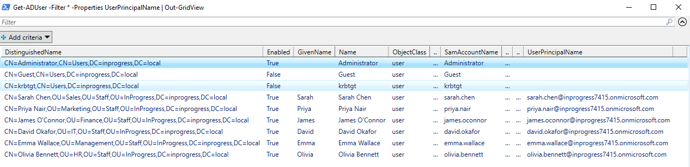
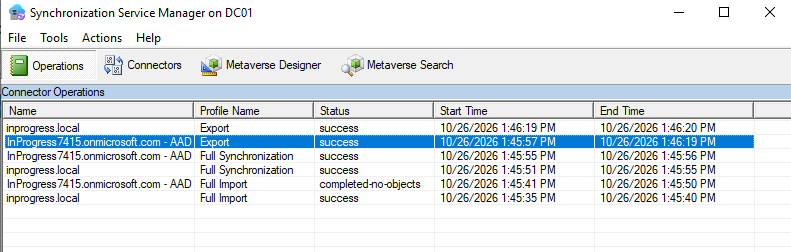
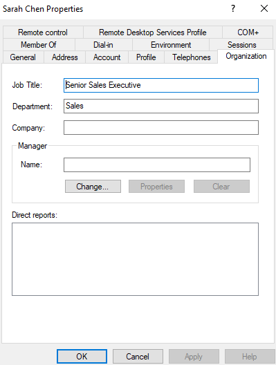
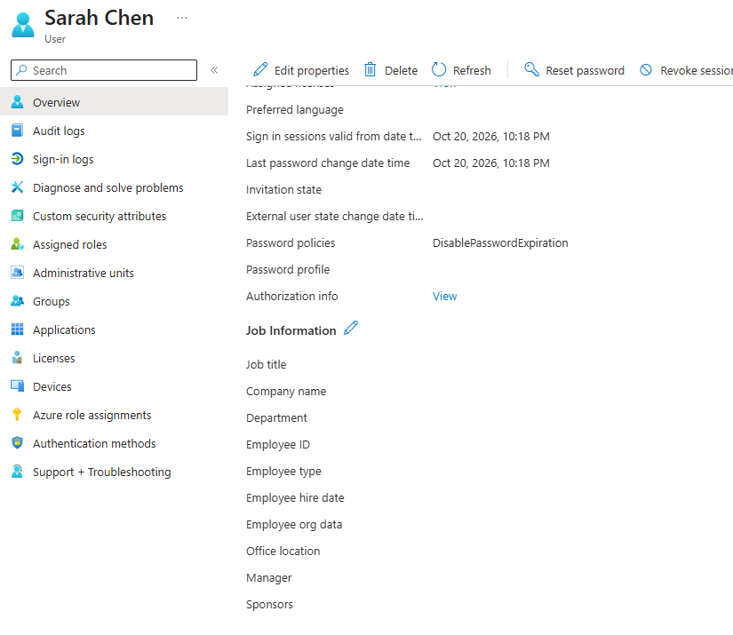
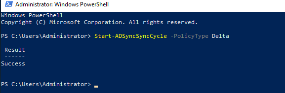
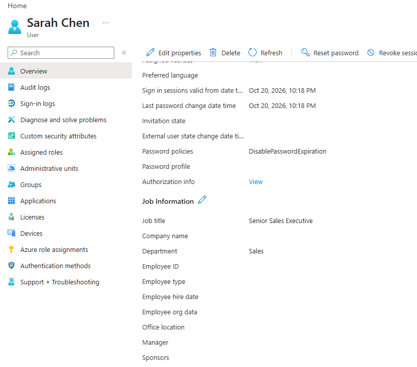
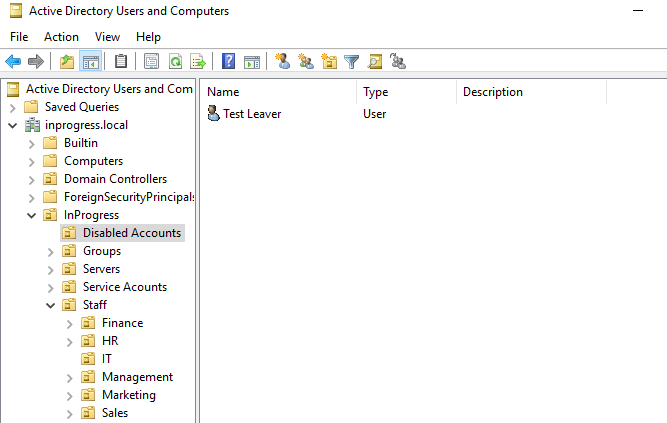
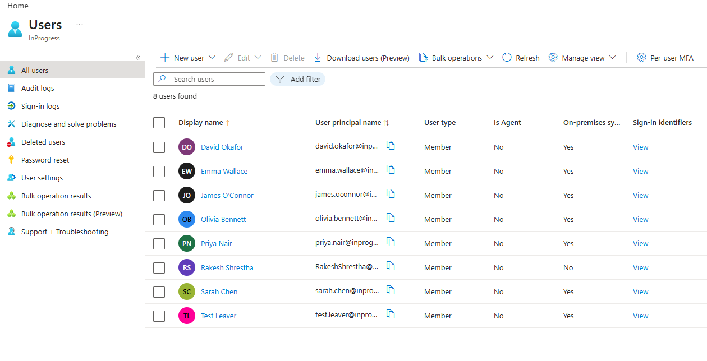
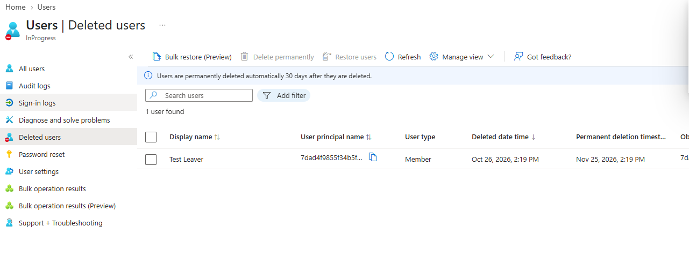

IT Support Lab - Phase 2: Hybrid Identity (Entra Connect)
==========================================================
Bridged the on-prem AD (inprogress.local) to my Microsoft 365 tenant so
users and groups I manage on DC01 show up in Entra ID, which is how most
small and mid-size companies actually run identity.

Sync server: DC01 (Entra Connect installed directly on the DC)
Tenant:inprogress7415.onmicrosoft.com
Sync scope: Staff, Groups, Workstations OUs under InProgress

------------------------------------------------------------
TASK 1: UPN suffix 
------------------------------------------------------------
My AD domain is inprogress.local, and .local can't be verified in
Microsoft 365, so users with @inprogress.local UPNs won't sync cleanly.
Rather than buying a domain, I used the tenant's built-in .onmicrosoft.com
domain, which is verified automatically. Added it as a UPN suffix in AD
Domains and Trusts, then bulk-updated my 6 test users with a PowerShell
script instead of editing each one in ADUC.

The script uses Get-ADUser with -SearchBase pointed at the Staff OU, so it
catches every user in every department sub-OU without me typing names.
 

------------------------------------------------------------
TASK 2: Install Entra Connect, scope the sync and verify 
------------------------------------------------------------
Installed with Customize instead of Express sync as I wanted control over scope. Chose Password Hash Sync, left
single sign-on off for now, connected with my tenant admin account on the
cloud side and INPROGRESS\Administrator on the AD side.

Scope decision, and a change of mind: I started out planning to sync only
the Staff OU. Before finishing I realised my security group
(SG-Finance-RW) lives in OU=Groups > Security Groups, so it wouldn't have
synced. I also added Workstations, because PC-1's computer object has to be in scope for hybrid join later.
Left Service Accounts, Disabled Accounts and Servers out on purpose, so
moving a leaver into Disabled Accounts pulls them out of the cloud.

Checked three places:
- Entra admin center > Users: all 6 test users present with
  inprogress7415.onmicrosoft.com UPNs and "On-premises sync enabled" = Yes.
- Entra admin center > Groups: SG-Finance-RW present with source
  Windows Server AD, james.oconnor listed as the member.
- Synchronization Service Manager on DC01 > Operations: export to the
  Entra connector showed success.

------------------------------------------------------------
TASK 3: Test that changes keep syncing
------------------------------------------------------------
Changed sarah.chen's Department and Job Title on-prem with Set-ADUser,
confirmed Entra still showed the old values, then ran
Start-ADSyncSyncCycle -PolicyType Delta on DC01 and confirmed the new
values appeared in Entra a minute or two later.

 

------------------------------------------------------------
TASK 4: Testing User changes like offboarding users
------------------------------------------------------------

Also tested the offboarding pattern: created a  user
(test.leaver) in Staff > IT, delta synced and saw it appear in Entra, then
moved it to Disabled Accounts and synced again. [fill in: what you saw -
it should show under Entra ID > Users > Deleted users, recoverable for 30
days.] That works because Disabled Accounts is outside the sync scope, so
Entra Connect removes the cloud object.

