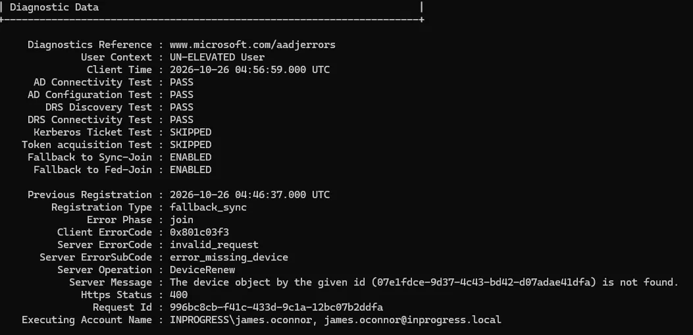
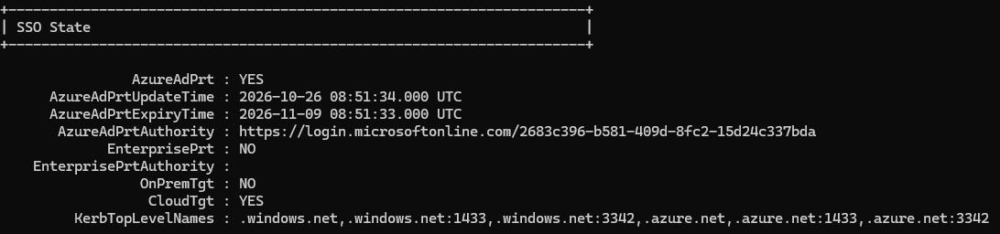
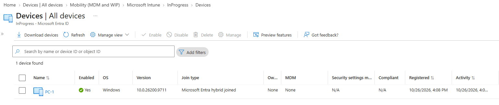

# Phase 3, Task 1: Hybrid Entra Join (PC-1)

**Goal:** make PC-1, my domain-joined Windows 11 client, a hybrid joined device, so it's known to both on-prem AD (`inprogress.local`) and Entra ID. 
Intune enrolment depends on this, so it had to come first.

**Environment:** DC01 (Windows Server 2019, with Entra Connect installed on it), PC-1 (Windows 11, domain-joined), test users synced from the Staff OU.

## What I did

1. On DC01, opened **Microsoft Entra Connect > Configure > Configure device options** and chose **Configure Hybrid Microsoft Entra join**.

2. Selected **Windows 10 or later domain-joined devices**, picked the forest `inprogress.local`, set the authentication service to **Microsoft Entra ID**, 
and used `INPROGRESS\Administrator` to create the SCP (the service connection point that tells domain PCs where to register).

3. Ran `Start-ADSyncSyncCycle -PolicyType Delta` so PC-1's computer object synced up. It appeared in Entra ID > Devices as **Pending**, which is normal until the device itself registers.

4. Signed in to PC-1 as `james.oconnor`, signed out and back in, and checked registration with `dsregcmd /status`.

## Problem 1: stuck on Pending, error `0x801c03f3`

PC-1 stayed Pending and `dsregcmd /status` showed `AzureAdJoined : NO`. The Diagnostic Data section told me what was going on:

**What it means:** PC-1 held a device ID, but Entra had no device object with that ID. My best explanation is a timing collision. PC-1 registered itself directly (`fallback_sync`) at about the same time Entra Connect synced its computer object, so the ID on the PC and the object in Entra ended up out of step.

**How I fixed it:** [I ran`dsregcmd /leave`, deleting the stale PC-1 object in Entra, and a delta sync]. After that, running the **Automatic-Device-Join** scheduled task (Task Scheduler > Microsoft > Windows > Workplace Join) registered the device, and a second delta sync updated Entra.

## Problem 2: `AzureAdPrt : NO` after the join

Once `AzureAdJoined` showed YES, `AzureAdPrt` was still NO. A PRT (primary refresh token) is what gives a user single sign-on to cloud resources, and it's only issued **at sign-in**. My session had started before the device finished joining.

**Fix:** a full sign-out and sign-in as `james.oconnor`, a synced user. After that the check showed YES.

Two things I learned here:
- The SSO State in `dsregcmd /status` belongs to whichever account runs the command. I'd run it elevated using the admin credentials, which reports the admin's state. `INPROGRESS\Administrator` isn't in my sync scope, so it has no PRT at all. Run it in a **normal** prompt as the synced user.
- `dsregcmd /status | findstr /i "AzureAdJoined DomainJoined AzureAdPrt"` shows just the three lines that matter.

## Result

- `AzureAdJoined : YES`, `DomainJoined : YES`, `AzureAdPrt : YES` for `james.oconnor` on PC-1
- PC-1 in Entra ID > Devices shows join type **Microsoft Entra hybrid joined** with a registered date

## What I'd take away from this

- Pending in Entra isn't a failure on its own. It means the computer object synced but the device hasn't registered yet.
- Read the Diagnostic Data section before changing anything. The passing tests told me what *wasn't* wrong, which narrowed it down fast.
- Registration is two stages: the device registers, then Entra Connect syncs the result. After the device side succeeds, I need a second sync.
- A PRT only appears at sign-in, so sign out and back in after any change to a device's join state.