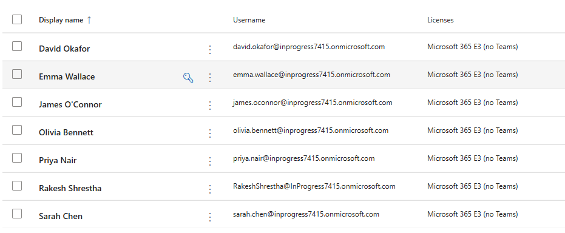
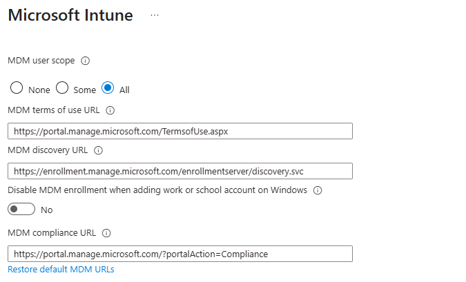
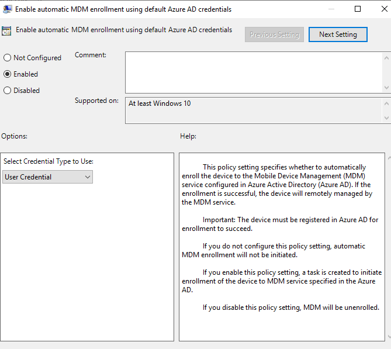
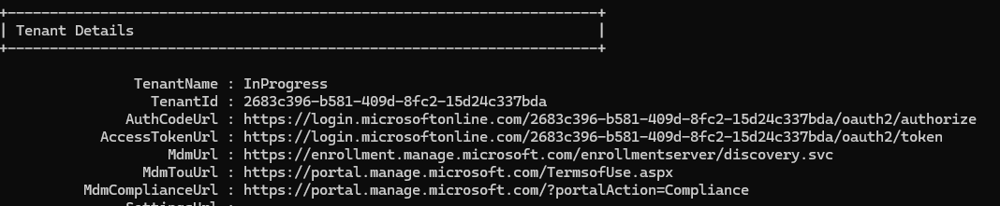
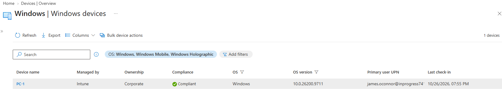

# Phase 3, Task 2: Intune Auto-Enrolment (PC-1)

**Goal:** get PC-1 enrolled in Microsoft Intune automatically through Group Policy, so the hybrid joined device becomes managed.

**Environment:** PC-1 (Windows 11, hybrid joined), users synced from the Staff OU, Microsoft 365 E3 trial tenant.

## What I set up first

1. **Licences:** set the usage location to Australia on the 6 test users (synced users have none, and licence assignment fails without it), 
		 then assigned **Microsoft 365 E3**, which includes Intune.

2. **MDM user scope:** in the Entra admin center under Mobility (MDM and MAM) > Microsoft Intune, set **MDM user scope** to **All**.

3. **Group Policy:** on DC01, created a GPO called `Intune-AutoEnrol`, linked to the **Workstations** OU, with *Enable automatic MDM enrollment 
		     using default Microsoft Entra credentials* set to **Enabled** and credential type **User Credential**.

## Applying it on PC-1

Signed in as `james.oconnor`, ran `gpupdate /force`, then signed out and back in. The **EnterpriseMgmt** folder appeared in Task Scheduler, 
and I ran the task *Schedule created by enrollment client for automatically enrolling in MDM from AAD*.

I stayed signed in as `james.oconnor` and opened Task Scheduler with "Run as administrator". I did that because I'd chosen **User Credential** enrolment, 
which uses the signed-in user's cloud identity. `INPROGRESS\Administrator` isn't synced to Entra, so enrolling from its session wouldn't work.

## Problem: `0x80180031`

The task's Last Run Result showed `0x80180031`, which means **MDM is not configured**: the device has no Intune enrolment URLs to talk to. 
Running `dsregcmd /status` and looking at **Tenant Details** confirmed it, with `MdmUrl`, `MdmTouUrl` and `MdmComplianceUrl` all blank.

**Fix:** [First, I check the scope and confirmed scope = All and saved, refreshed registration with the Automatic-Device-Join task, signed out, restarted PC-1 and back in]. 
Once the URLs appeared, PC-1 enrolled on its own and I didn't need to rerun the task. After a few minutes, I checked Intune to confirm and the device appeared wtih
**Managed by: Intune** and a hybrid joined join type]

## What I'd take away from this

- `dsregcmd /status` shows the MDM URLs in one place, so it's the first thing I'd check next time.
- A device can register before the MDM scope is set and miss the URLs, so the order matters: licences and scope first, GPO second.
- User-credential enrolment depends on the signed-in user having a PRT, which ties this task back to the hybrid join work.