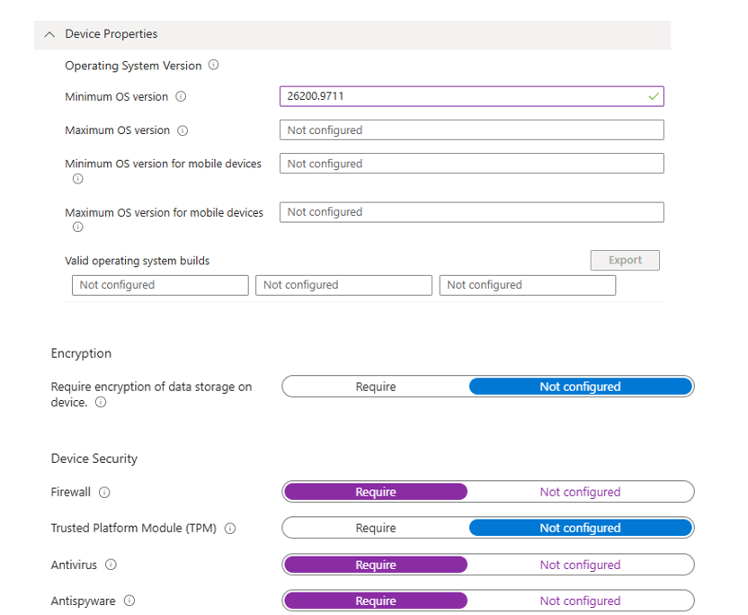
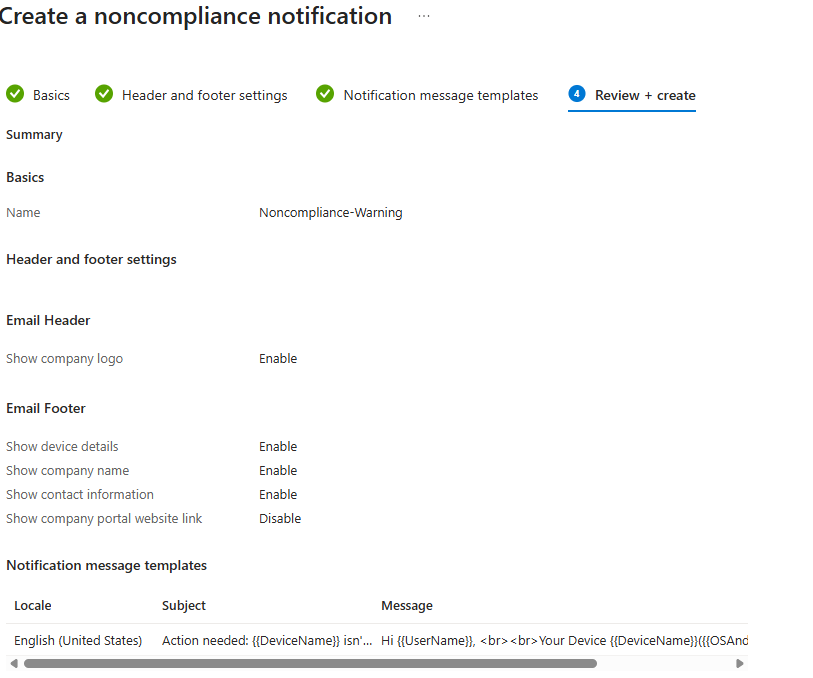
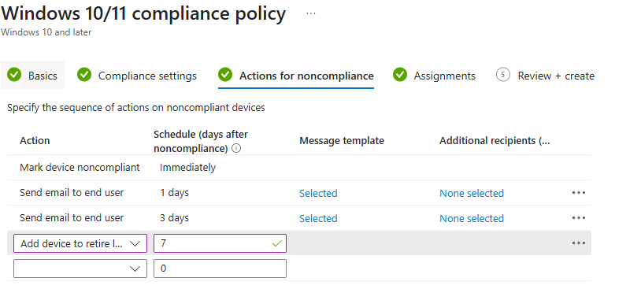
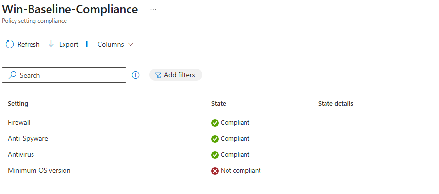
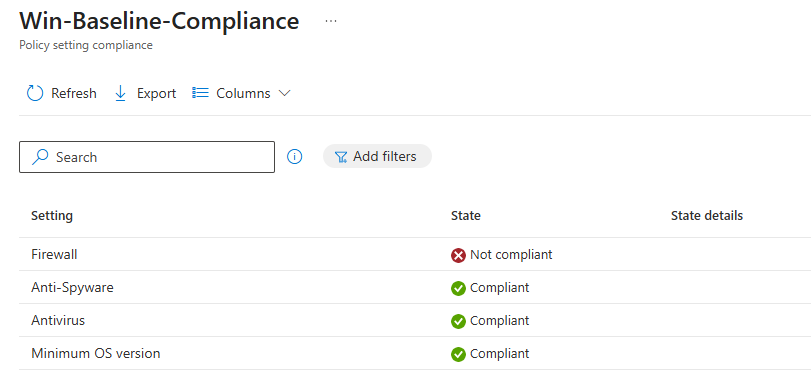
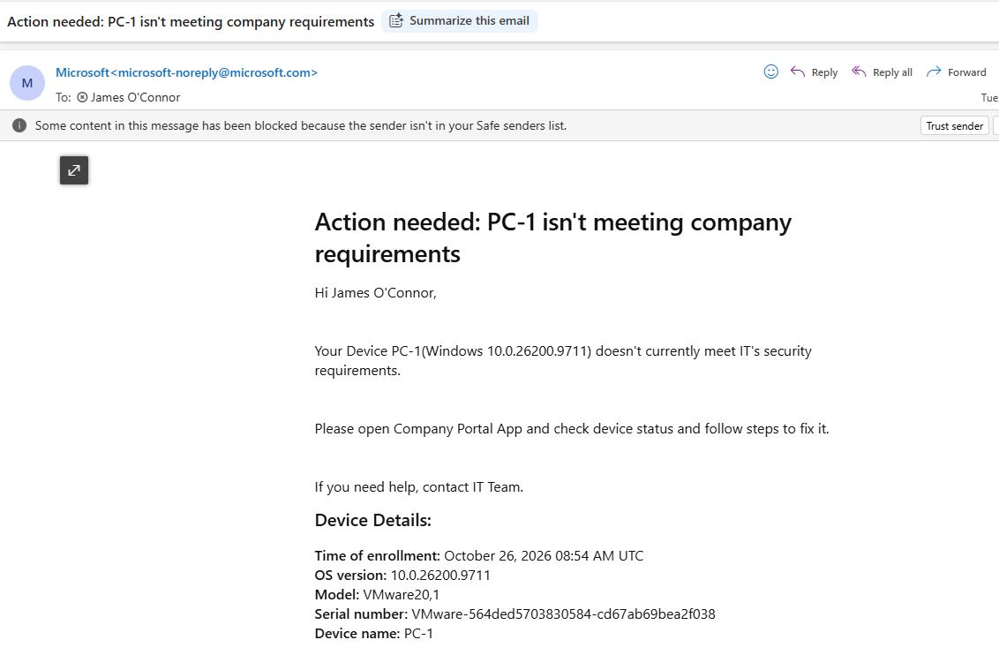

# Phase 3, Task 3: Intune Compliance Policy with Staged Remediation (PC-1)

**Goal:** define what a "healthy" Windows device looks like, have Intune check PC-1 against it, and 
set up a staged response when a device falls out of compliance: warn the user by email, mark the device noncompliant, then queue it for retirement.

**Environment:** PC-1 (Windows 11, hybrid joined and Intune enrolled), primary user `james.oconnor`, Microsoft 365 E3 trial tenant.

## What I set up

**Policy:** `Win-Baseline-Compliance` (profile type *Windows 10 and later*), with these settings:
- Firewall: required
- Antivirus: required
- Antispyware: required
- Minimum OS version: set to a build number (see Problem 1)

**Notification template:** `Noncompliance-Warning`, a branded email using the `{{UserName}}`, `{{DeviceName}}` and `{{OSAndVersion}}` tokens, with English set as the default locale.

**Actions for noncompliance:**

| Day | Action |
|-----|--------|
| 0 | Mark device noncompliant |
| 1 | Send email to end user (`Noncompliance-Warning`) |
| 3 | Send email to end user (reminder) |
| 7 | Add device to retire list |

**Assignment:** [Assigned policy to All users]

## Problem 1: PC-1 showed Not compliant on OS version

PC-1 failed the OS version check even though it was fully up to date. The cause was the **format** of the value I'd typed. 
Intune compares against the full `10.0.build.revision` string, and PC-1 reports build `26200.9711`, so a minimum that didn't match that pattern failed.

**Fix:** set the minimum OS version to the format `10.0.26100.0` (a lower baseline), and set Maximum OS version to **Not configured**. After a sync, PC-1 evaluated as compliant.

I diagnosed it from the device's per-setting status (Devices > PC-1 > Device compliance > policy), which names the exact setting that failed rather than just showing "Not compliant".

## Negative test

To see the whole flow work, I set the email action to **0 days** temporarily, turned the Windows firewall off on PC-1, and synced the device.

1. Firewall off, synced: PC-1 went to **Not compliant** and the failing setting was Firewall.
2. An email was received in James account stating device is not complaint. 
3. Firewall back on, synced: PC-1 returned to **Compliant**.
4. Email action set back to **1 day**.

## What I'd take away from this

- A compliance policy states a standard. What matters operationally is the **actions** attached to it, and what blocks access is a separate Conditional Access policy.
- Version values must match the exact `major.minor.build.revision` format, or a perfectly healthy device fails.
- Use the per-setting status first when a device is noncompliant. It names the cause directly.
- Test notifications by making a real device noncompliant. The preview can't prove delivery.
- Sync the device (on the device and in the portal) before expecting a status change, then give it several minutes.
